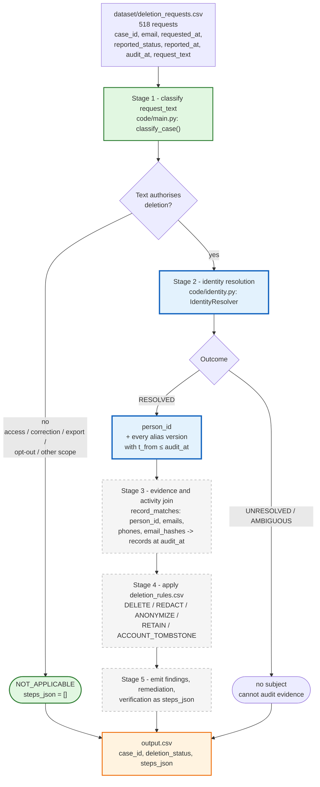
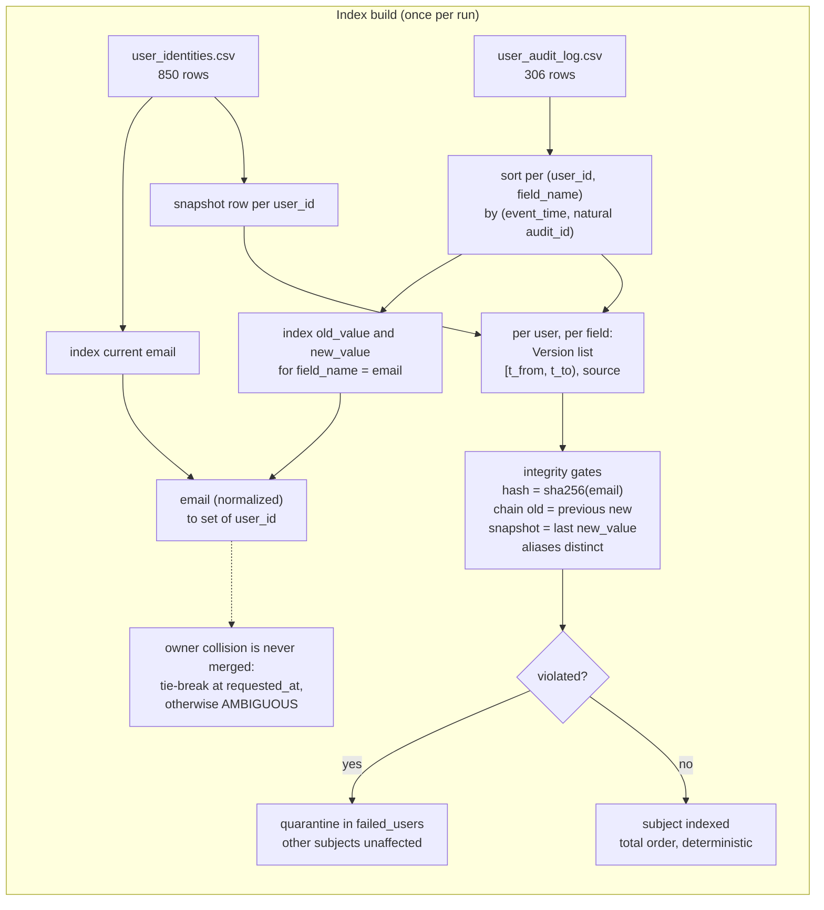
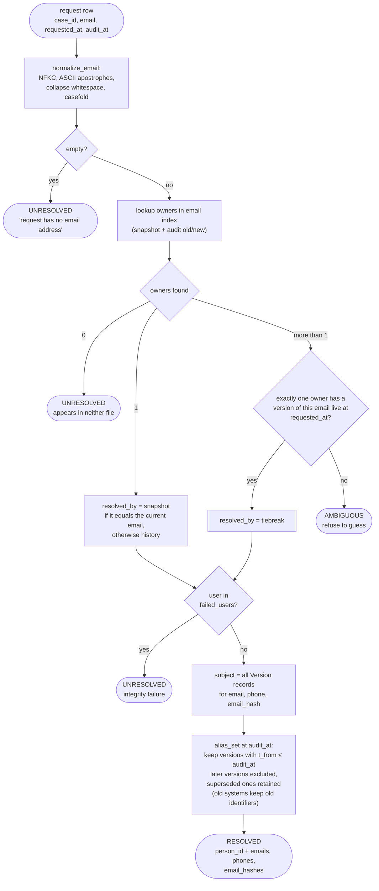

# Identity Resolution Flowcharts (Mermaid)

Two diagrams, both derived from the implemented code (`code/identity.py`, wired in by
`code/main.py`):

1. **Pipeline view** - where identity resolution sits in the 518-case run, and what is
   still missing.
2. **Resolver view** - the actual control flow of `IdentityResolver` for one request.

Inputs are only `dataset/deletion_requests.csv`, `dataset/user_identities.csv` and
`dataset/user_audit_log.csv`.

---

## 1. Pipeline view

Stage status: stage 1 and identity resolution are implemented and tested; stages 3-5
are next. `output.csv` currently carries the stage-1 verdicts plus a provisional
`INCOMPLETE` for every authorised request.

---

## 2. Resolver view

### 2a. Construction - once per run

### 2b. Resolving one request

Key properties of the cutoff: `audit_at` bounds the alias set **from below only**
(`t_from <= audit_at`). A version created after `audit_at` is excluded because it did not
exist at decision time; a superseded version is never dropped, because the old address
may still sit in logs, exports, replicas or support attachments.

---

## 3. Why this is deterministic

- **No fuzzy matching, no name matching, no model call.** Three users share a display
  name in the dataset, so names are never a join key.
- **One value has one owner.** A colliding value is never silently merged: it either
  tie-breaks on validity at `requested_at` or returns `AMBIGUOUS`.
- **Total ordering.** `(event_time, audit_id)` gives the same version windows on every
  run, whatever order the CSV rows arrive in.
- **Integrity is checked, not assumed.** `email_hash == sha256(email)`, chain continuity
  and snapshot consistency are verified from the data at construction (all 850 subjects
  pass today); a failing subject is quarantined instead of corrupting an answer.
- **Explicit failure.** Resolution returns `UNRESOLVED` or `AMBIGUOUS` with a reason
  string rather than a low-confidence guess.

## 4. Reference run

| Metric | Value |
|---|---|
| Requests resolved | 518 / 518 |
| Distinct people | 517 (`case_33` and `case_52` share `user_18`) |
| Matched on current snapshot email | 418 |
| Matched only through history | 100 |
| Email versions recovered | 620 |
| Phone versions recovered | 607 |
| Alias contamination | 0 |
| Integrity failures | 0 |
| Versions lost at `audit_at` | 0 |
| Sample attribution vs naive baseline | 32/32 vs 29/32 (+9.4 pp) |
